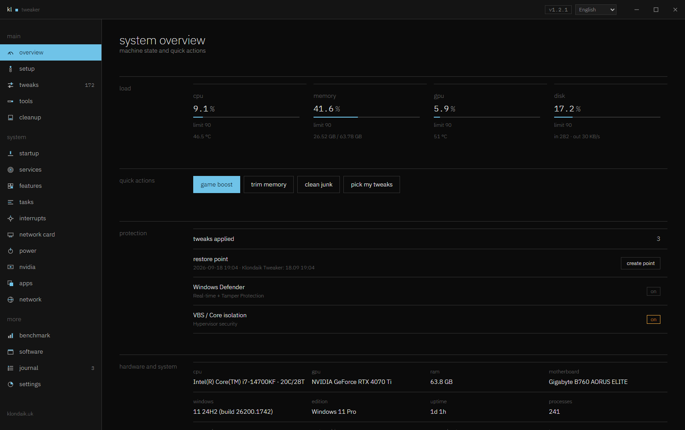
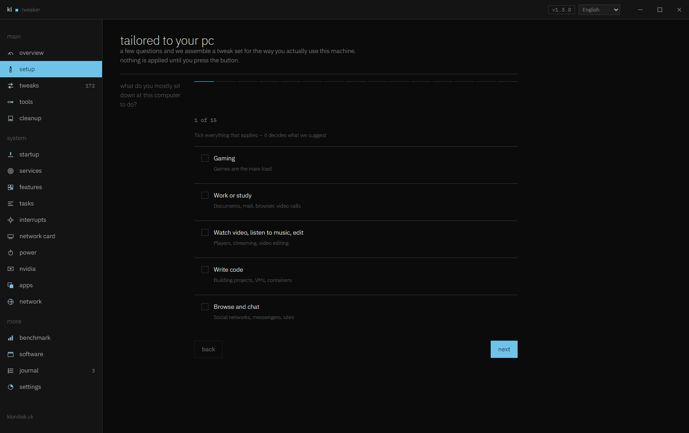
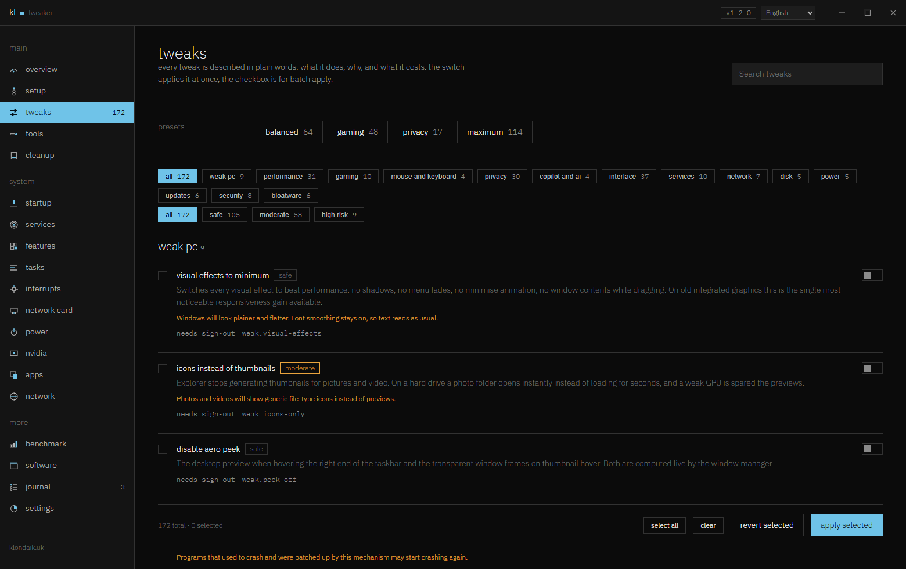
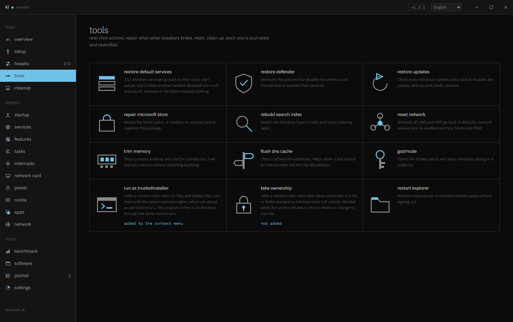
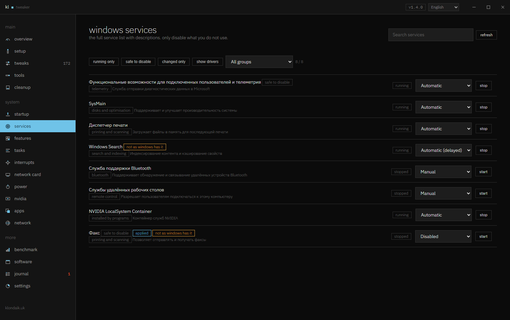
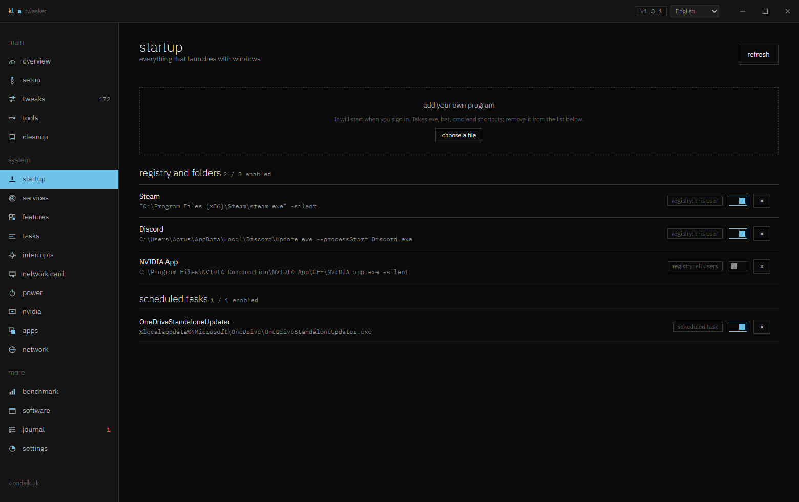

[Русский](README.md) · **English**

# Klondaik Tweaker


A Windows tweaker that remembers what it did. Before every change the previous
value of the key, service or task goes into a journal, and any tweak is
reverted on its own — not by resetting everything, but by undoing the one you
should not have turned on.

The usual tweaker applies a set and forgets it, and what exactly it changed is
no longer anywhere to be found. Here the journal is written before the change
rather than after, so reverting restores the value you had, not the default.



## What it does

- **172 tweaks** across three risk levels — 105 safe, 58 advanced and 9
  extreme. Each is described in Russian and English: what it does, why, and
  what it costs you.
- **Guided picking** — up to 21 questions, with the ones that do not apply to
  your hardware or your answers dropped. Nothing is applied until you press the
  button.
- **A "Weak PC" category** — visual effects, thumbnails, memory compression and
  the page file, the things that change how old hardware responds instead of
  adding placebo.
- **Per-tweak rollback** — the journal keeps the previous state, and applying
  the same tweak again does not overwrite the original record.
- **A check that tweaks still hold** — Windows puts some values back after an
  update. The program compares what was applied against the system at startup
  and shows the number of drifted tweaks in the menu; one button applies them
  again.
- **The applied set in a file** — what is applied is saved as one file and
  applied on another machine. The file holds tweak identifiers, not registry
  values.
- **TrustedInstaller rights** — keys and services that refuse even an
  administrator are taken with the system service token.
- **Repair tools** — one-click fixes for what other tweakers broke: services
  back to their stock start values, Defender, Windows Update, the Store,
  search, the network stack.
- **Interrupts and cores** — pinning the interrupts of the GPU, the mouse and
  the network card to chosen processor threads, with P-cores and E-cores told
  apart.
- **Network adapter parameters** — everything the driver exposes, with a
  low-latency preset.
- **Scheduler tasks** — 12 groups, 54 tasks, each group explained along with
  what stops working when you switch it off.
- **Windows features** — 27 optional features through DISM, each with what it
  is, what it is for and whether it is unsafe to leave on.
- **Services by group** — 24 groups by meaning, plus a separate group for
  services that came from your own programs rather than from Windows. Device
  drivers are marked and kept out of sight until you ask for them.
- **Power schemes** — switching, export, import and the hidden settings Windows
  keeps out of the Control Panel.
- **Ghost devices** — records of hardware that is no longer in the machine.
  Disks, volumes and system classes are left alone.
- **NVIDIA panel** — driver profiles through the bundled Profile Inspector,
  with export and import.
- **Cleanup, startup, built-in apps, network** — every action is written to the
  journal as well. Your own program goes into startup through a file picker,
  and cleanup has a separate line for the data folders of apps you removed long
  ago.
- **Benchmark** — processor, memory, disk and responsiveness, so "before" and
  "after" can be compared as numbers rather than impressions.
- **One portable exe** — 54.2 MB, no installer, no .NET on the user's machine,
  settings in `%ProgramData%\KlondaikTweaker`.
- **Eleven interface languages**: Russian, Ukrainian, Belarusian, Kazakh,
  Uzbek, Azerbaijani, English, German, Polish, Spanish and French.

## Warning

The program changes the registry, services, scheduled tasks, installed packages
and network settings of Windows. Such changes **can make the system unstable,
switch protection off and block updates**.

You use it at your own risk. The copyright holder is not liable for breakage,
downtime, data loss, disabled protection or any other consequence — whether you
applied a tweak by hand, through the wizard or as a preset. The journal and a
restore point lower the risk but guarantee nothing — back up what you care
about.

The full text is in [LICENSE](LICENSE). The program shows this same warning on
first start and will not go further without your consent.

## Quick start

Download `KlondaikTweaker.exe` from [releases](../../releases/latest) and run it
as administrator. There is nothing to install, it is a single file.
`KlondaikTweaker.exe.sha256` sits next to it for checking the download.

You need Windows 10 1903 or newer, or Windows 11, and the WebView2 Runtime — it
is already there on Windows 11 and on up-to-date Windows 10; otherwise the
program gives you the link.

## Guided picking

The program works out the hardware class from the amount of memory, the thread
count and the type of system drive, then asks about scenarios: games, work, an
old laptop, whether you need Defender, whether updates matter. Questions that
do not apply to this machine are not asked.

The result is a list with checkboxes rather than "apply everything": every
tweak can be unchecked once you have read what it risks.



## Tweak catalogue

Fourteen categories, three risk levels, search over titles and descriptions,
four ready-made sets. The switch applies a tweak immediately, the checkbox
collects it for a batch. Extreme tweaks stay hidden until you turn them on in
the settings, and ask for a separate confirmation listing exactly what will be
switched off.

Your own set is saved to a file and applied on another machine — the buttons
sit next to the ready-made sets. The file carries tweak identifiers, so it
cannot bring a registry write of its own; a file that is not ours, or is
damaged, is refused with a reason.



## Repair tools

A tab for fixing rather than breaking. Another tweaker switched off services it
should not have and sound, networking or the Store stopped working — "Restore
default services" puts 232 services back to their stock start values.



## Services

The full list with descriptions, laid out in 24 groups: printing, Bluetooth,
VPN, remote access, Hyper-V, indexing and so on. A separate group shows the
services that came from your own programs rather than from Windows, which is
visible from where the file is started. Device drivers are marked and hidden by
default — on an ordinary machine there are 445 of them out of 759, and they
only make the list harder to read. The "changed only" filter shows what differs
from the stock value.



## Startup

The registry, the startup folders and scheduler tasks in one list, each entry
saying where it comes from. Your own program is added through a file picker:
exe and bat files go into the registry, a shortcut is copied into the startup
folder.



## Rollback, journal and the drift check

- Before a tweak is applied its previous state is written to
  `%ProgramData%\KlondaikTweaker\journal.json`.
- Applying again does not overwrite the original record, so a revert always
  returns the first value rather than an intermediate one.
- For advanced and extreme tweaks a restore point is created before a batch.
- Reverting works one by one and all at once on the Journal tab.
- At startup the program compares what was applied against the system and shows
  in the menu how many tweaks drifted. "Apply again" puts back exactly those.
- When every target of a tweak is absent from this system it is marked
  unavailable rather than "not applied", so the switch does not look broken.

## Updating

Settings → Update → Check for updates. The program asks GitHub for the latest
release and shows the version, the size and the changes. "Download and install"
fetches the file with a progress bar, closes the program, replaces the exe and
starts it again. Settings, the journal and the benchmark history stay where
they are.

It downloads and installs nothing on its own, only on that button. The download
address is checked on the program's side rather than taken on trust from the
server's answer.

## TrustedInstaller rights

Not everything in Windows yields to an administrator. Some registry keys,
services and tasks belong to `TrustedInstaller`, and a plain write fails with
access denied. Writing goes through three steps, each one used only when the
previous one failed:

1. A plain write as administrator.
2. Taking ownership of the key for the Administrators group and granting full
   control.
3. Running the operation under the `TrustedInstaller` token, falling back to
   `SYSTEM`.

The token is taken straight from the `TrustedInstaller` service process through
`OpenProcessToken` and `DuplicateTokenEx` — the same technique as `RunAsTI` in
Atlas, but natively in C# with no intermediate scripts. The `SeTakeOwnership`,
`SeRestore`, `SeBackup`, `SeDebug` and `SeImpersonate` privileges are enabled in
the process token at start.

## What the program does not do

- **Tweak descriptions are translated into two languages** out of eleven,
  Russian and English. The interface speaks eleven, the descriptions do not.
- **Defender tweaks will not apply while tamper protection is on.** The program
  warns about it at startup.
- **A saved set does not carry** the state of services, scheduler tasks,
  features, power schemes or network adapter parameters — only catalogue
  tweaks.
- **No scheduled task is created.** While the program is closed, nothing is
  checked and nothing is applied.
- **It does not open without administrator rights** — the manifest says
  `requireAdministrator`, so looking around without granting them is not
  possible.
- **The build is not signed**, so SmartScreen warns about an unknown publisher
  on first run. The SHA-256 sum is published next to the exe in the release.
- **System boot time** is read from the event log and needs administrator
  rights, and **CPU temperature** comes from ACPI and is not available on every
  motherboard.

## How it is built

```
src/KlondaikTweaker/
  MainForm.cs          frameless WinForms window, WebView2, assets from resources
  Program.cs           elevation, self-test modes from the command line
  Host/Api.cs          one method to object router, postMessage JSON bridge
  Host/SelfTest.cs     backend checks and an end-to-end apply-and-revert test
  Host/ModuleTest.cs   a real run of every module, reported after each step
  Core/Engine/         detection, apply, revert, journal, hardware facts
  Core/Modules/        cleanup, services, startup, apps, network, benchmark,
                       game boost, software catalogue, repair, update, sets
  Core/Win/            registry with privilege escalation, TrustedInstaller token
  Assets/Data/         tweaks, wizard, software catalogue, service defaults
  Assets/wwwroot/      HTML, CSS and ES modules with no bundler, fonts
tools/                 Python data generators and the test-machine package
docs/                  screenshots, the script that rebuilds them, release notes
build.ps1              data generation and exe publishing
```

**Interface.** Files are served straight from assembly resources at
`https://app.klondaik/`, and navigation outside that address is blocked. No npm
and no bundler, just plain ES modules.

**Signs.** Thirty-one signs — nineteen in the menu and twelve on the Tools
cards — are drawn from circles, arcs and rectangles. There is no icon library
and no 3D library either — that one weighed 704 kB and drew shapes that spent
half their time turned edge-on and unreadable.

**Data.** Tweaks are written in Python rather than JSON by hand. The generator
collects 172 records and checks identifier uniqueness, registry hives, value
types and non-empty descriptions in both languages, and exits non-zero on an
error.

**Build.** `CetCompat` is off in the csproj — with it .NET 10 marks the exe as
Intel CET compatible, and on Windows 10 builds without full CET support the
process dies before `Main` with `0x80131506`. Hardware facts come from the
registry, WinAPI and a few PowerShell calls, because `System.Management` (WMI)
does not work in .NET 10 single-file builds.

## Building from source

```bash
git clone https://github.com/KrekerDM/klondaik-tweaker.git
```

```powershell
.\build.ps1
```

You need the .NET SDK 10 and Python 3 for the data generators. The script
regenerates `Assets/Data/*.json`, publishes a self-contained single-file build
into `dist/` and packs a separate bundle for testing in a virtual machine.

The interface without a UAC prompt — the window works, writing to the system
does not:

```powershell
dotnet publish src\KlondaikTweaker -c Release -o out -p:ApplicationManifest=app.dev.manifest
```

```powershell
$env:KLONDAIK_UI_PREVIEW = "1"; .\out\KlondaikTweaker.exe
```

## Adding a tweak

Tweaks live in `tools/tweaks_a.py` … `tweaks_e.py`:

```python
T("perf.example", "performance", "advanced",
  ("Заголовок", "Что это и зачем", "Чем рискуете"),
  ("Title", "What and why", "What it costs"),
  [R("HKLM", CCS + r"\Control\Example", "Value", "dword", 1, 0)],
  tags=["fps"], src="atlas", restart=True)
```

```powershell
python tools\gen_tweaks.py
```

Action kinds: `R` registry, `RD` delete a value, `SV` service, `TK` scheduler
task, `AX` app package, `CM` command, `PS` PowerShell, `HS` hosts entries. The
`req` field limits a tweak to a system: `win11`, `ssd`, `laptop`, `desktop`,
`nvidia`, `b24h2`, `lowram`, `highram`, `weakcpu`, `weak`, `strong`.

The table of stock start values for 232 services lives in
`tools/service_defaults.txt` and is built with `python tools\gen_repair.py`.

## How it is checked

A backend self-test, read-only, no administrator rights needed:

```powershell
.\dist\KlondaikTweaker.exe --selftest report.txt
```

A rollback check on a throwaway registry key, nothing system-wide is touched:

```powershell
.\dist\KlondaikTweaker.exe --selftest-apply report.txt --canary-only
```

A run over **the whole catalogue**: every tweak is applied, its detection is
checked, it is reverted and compared against the original state. **In a virtual
machine only.**

```powershell
.\dist\KlondaikTweaker.exe --selftest-apply report.txt --all
```

A module run that really performs cleanup, the benchmark, game boost, every
Tools button, a restore point and a network reset. The report is written after
each step, so an interruption halfway does not lose the result. **In a virtual
machine only.**

```powershell
.\dist\KlondaikTweaker.exe --selftest-modules report.txt
```

An interface speed measurement, read-only — every call is made twice, cold and
warm.

```powershell
.\dist\KlondaikTweaker.exe --perf report.txt
```

On Windows 10 22H2 in a virtual machine the latest build passed all four runs:
**173 of 173** in the full catalogue round trip — 172 tweaks and the rollback
canary, each applied, checked, reverted and compared against the original
state; **29 of 29** backend checks and **42 of 42** modules.

A build is not released until three checks in the repository pass: eleven
interface dictionaries with the same set of keys, an English variant for every
string in the core, and every embedded resource present in the published exe.

The screenshots in this README are rebuilt from the same `wwwroot` that goes
into the exe:

```powershell
python docs\make_screenshots.py
```

## Sources

Registry paths and parameter values are facts about how Windows works, not
someone else's code. The engine, the descriptions and the interface are written
from scratch. The projects whose ideas, data and techniques were used are
listed inside the program on the Settings tab:
[Atlas OS](https://github.com/Atlas-OS/Atlas) (GPL v3, he3als and Xyueta),
All Tweaker (MIT, Nikita Solomon),
[LeanAndMean](https://github.com/AveYo/LeanAndMean) (MIT, AveYo),
[TimerResolution](https://github.com/amitxv/TimerResolution) (amitxv),
ios1ph optimization,
[IBM Plex](https://github.com/IBM/plex) (SIL OFL 1.1).

## License

MIT — see [LICENSE](LICENSE), including a separate disclaimer for the
consequences of changing the system.

Fonts are IBM Plex (SIL OFL 1.1).
